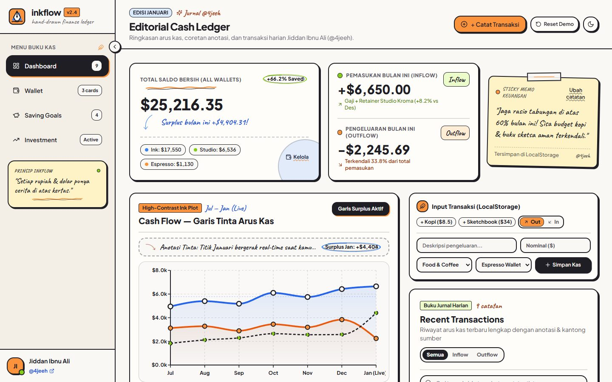
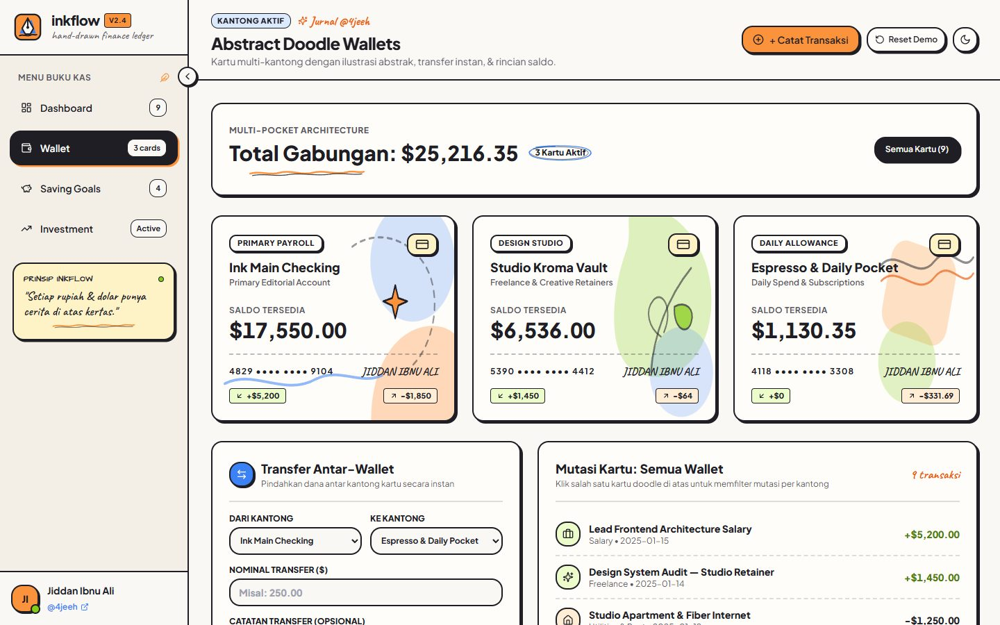
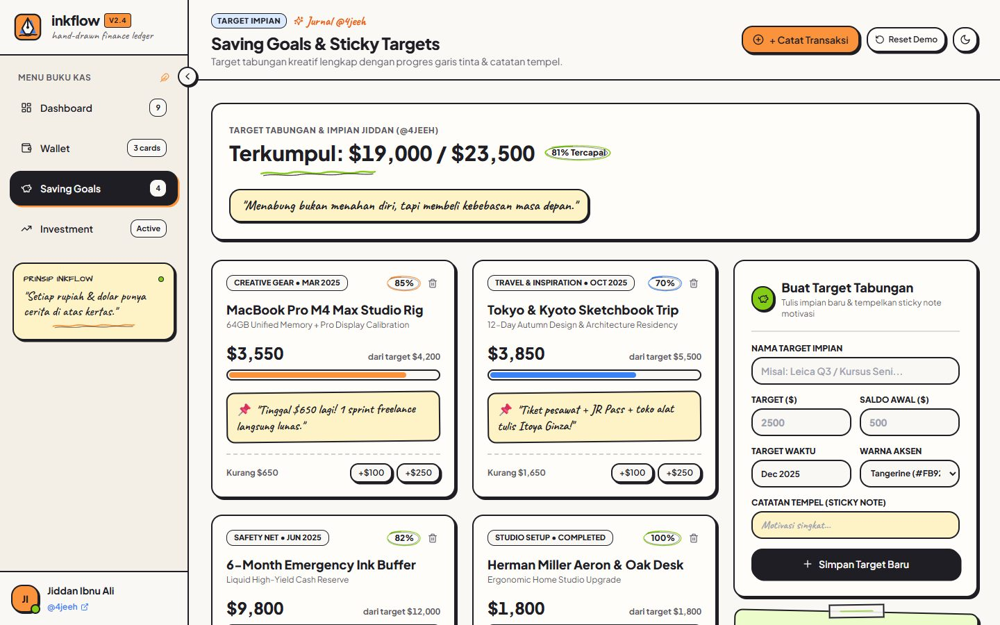

# `INKFLOW` // Warm Editorial Personal Finance & Hand-Drawn Ledger

[](https://github.com/4jeeh/inkflow)
[](./src/index.css)
[](./package.json)
[](./src/context/FinanceContext.tsx)
[](./LICENSE)

> **Crafted by:** **Jiddan Ibnu Ali** ([@4jeeh](https://github.com/4jeeh))  
> **Repository:** [https://github.com/4jeeh/inkflow](https://github.com/4jeeh/inkflow)

---

## 1.0 OVERVIEW

**`inkflow`** is an artisan personal finance web application and cash flow ledger built around a **Warm Editorial Fintech with Hand-Drawn Doodles & Abstract Shapes** aesthetic.

Replacing sterile, neon-purple AI dashboard templates (`manajemen-keuangan` / `vite_react_shadcn_ts`), **`inkflow`** treats personal bookkeeping like a tactile physical sketchbook and editorial ledger—pairing warm cream paper surfaces (`#FAF8F5`), deep fountain-pen ink borders (`#1E1E24`), custom SVG hand-drawn doodle ornaments, high-contrast ink line charts, and real-time `localStorage` state persistence.

---

## 2.0 VISUAL PREVIEW

### 2.1 Editorial Dashboard (`/`)


### 2.2 Abstract Doodle Wallets (`/wallet`)


### 2.3 Saving Goals & Sticky Targets (`/savings`)


---

## 3.0 DESIGN SYSTEM & AESTHETIC PHILOSOPHY (0% AI-SLOP)

### 3.1 Color Palette

| Token Role | Hex Code | Visual Purpose |
| :--- | :--- | :--- |
| **Warm Cream / Paper Canvas** | `#FAF8F5` | Primary page canvas with subtle dotted sketchbook grid |
| **Crisp Warm Card Sheet** | `#FFFDF9` | Elevated editorial cards and ledger containers |
| **Deep Ink Borders & Text** | `#1E1E24` | `2px solid` structural borders, offset ink shadows (`3px 3px 0px #1E1E24`), and primary typography |
| **Tangerine Accent** | `#FB923C` | Outflow series, primary CTA buttons, wavy underlines, and warm highlights |
| **Cobalt Accent** | `#3B82F6` | Inflow series, primary checking wallet art, and analytical callouts |
| **Sage Accent** | `#84CC16` | Positive cash surplus, savings rate rings, and goal completion bars |
| **Sticky Note Paper** | `#FEF3C7` | Tactile yellow memo notes with masking-tape header strips |

### 3.2 Hand-Drawn SVG Ornaments (`src/components/doodles/DoodleElements.tsx`)

- **`WavyUnderline`**: Double-stroke hand-drawn wavy underline beneath primary balance titles and section headers.
- **`DoodleCircle`**: Irregular hand-sketched double loop highlighting savings rates (`+66.2% Saved`) and monthly surplus figures.
- **`SketchedArrow`**: Curved fountain-pen arrow connecting handwritten annotations to live chart peaks and KPIs.
- **`StickyNote`**: Tilted paper sticky notes with top masking tape and inline `localStorage` editing.
- **`AbstractWalletArt`**: Bespoke vector compositions (`cobalt-arch`, `sage-botanical`, `tangerine-bauhaus`) for multi-pocket wallet cards.

### 3.3 Typography

- **Primary UI & Numerical Ledger**: `'Plus Jakarta Sans'` & `'Inter'` with `font-variant-numeric: tabular-nums` for vertical digit alignment.
- **Handwritten Annotations**: `'Caveat'` cursive script for personal memos, sticky notes, and chart annotations.

---

## 4.0 ARCHITECTURAL TRANSFORMATION

| Dimension | Legacy Template (`manajemen-keuangan`) | Modernized **`inkflow`** (`v1.0.0`) |
| :--- | :--- | :--- |
| **Identity & Heritage** | `vite_react_shadcn_ts` with `lovable-tagger` & `John Doe` | Clean **`inkflow`** identity owned by **Jiddan Ibnu Ali (`@4jeeh`)**, zero bot taggers |
| **Visual Language** | Cold neon-indigo gradients & generic borderless soft-shadow cards | Warm Cream Paper (`#FAF8F5`), Deep Ink Borders (`#1E1E24`), & custom SVG Doodles |
| **Cash Flow Chart** | Dim, low-opacity 2px gradient area chart | **High-Contrast Ink Line Chart** (`4px` Cobalt Inflow, `3.75px` Tangerine Outflow, dashed Net Surplus) |
| **Sidebar Routing** | Only `/` worked; `/wallet`, `/savings`, `/investment` returned `404` | **100% Functional Routes**: Dashboard (`/`), Wallet (`/wallet`), Saving Goals (`/savings`), Investment (`/investment`) |
| **Interactivity & State** | Static hardcoded `mockData.ts` array | **Live `FinanceContext` + `localStorage` Engine** (add/delete transactions, transfer between wallets, top-up & create saving goals, edit sticky memos) |

---

## 5.0 PROJECT STRUCTURE

```text
inkflow/
├── docs/
│   ├── preview-dashboard.jpg             # Live Dashboard screenshot
│   ├── preview-wallet.jpg                # Abstract Doodle Wallets screenshot
│   └── preview-savings.jpg               # Saving Goals & Sticky Targets screenshot
├── public/
│   ├── favicon.ico
│   └── robots.txt
├── src/
│   ├── components/
│   │   ├── doodles/
│   │   │   └── DoodleElements.tsx        # Custom SVG doodles (WavyUnderline, DoodleCircle, SketchedArrow, StickyNote, AbstractWalletArt)
│   │   ├── dashboard/
│   │   │   ├── AppShell.tsx              # Shared responsive editorial layout shell
│   │   │   ├── AppSidebar.tsx            # Ink-bordered sidebar with Jiddan Ibnu Ali (@4jeeh) profile
│   │   │   ├── DashboardHeader.tsx       # Route header, quick-entry trigger, demo reset & theme switch
│   │   │   ├── StatsCards.tsx            # Hero Net Balance, Inflow/Outflow split & editable Sticky Note
│   │   │   ├── CashFlowChart.tsx         # High-contrast thick ink line chart & top expense category breakdown
│   │   │   ├── TransactionComposer.tsx   # Interactive LocalStorage transaction input studio
│   │   │   ├── RecentTransactions.tsx    # Searchable & filterable transaction ledger with delete action
│   │   │   └── MobileNav.tsx             # Mobile bottom navigation bar
│   │   └── ui/                           # Base accessible UI primitives
│   ├── context/
│   │   └── FinanceContext.tsx            # Reactive state & LocalStorage persistence engine
│   ├── data/
│   │   └── mockData.ts                   # Initial realistic dataset & category icon mapping
│   ├── hooks/
│   │   └── useTheme.tsx                  # Paper Cream (light) & Charcoal Sketchbook (dark) theme hook
│   ├── pages/
│   │   ├── Index.tsx                     # Main Editorial Cash Ledger Dashboard (/)
│   │   ├── WalletPage.tsx                # Abstract Doodle Wallets & Inter-Wallet Transfer (/wallet)
│   │   ├── SavingsPage.tsx               # Saving Goals & Sticky Note Milestones (/savings)
│   │   ├── InvestmentPage.tsx            # Long-Term Portfolio & Asset Allocation (/investment)
│   │   └── NotFound.tsx                  # Custom doodle-styled 404 fallback page
│   ├── App.tsx                           # Router & provider tree
│   ├── index.css                         # Warm Editorial design tokens & .ink-card / .ink-button utilities
│   └── main.tsx                          # Application entry point
├── .gitignore                            # Git ignore rules
├── index.html                            # HTML entry with Google Fonts (Plus Jakarta Sans, Inter, Caveat)
├── LICENSE                               # MIT License
├── package.json                          # Project metadata, scripts & dependencies
├── README.md                             # Project documentation
├── tailwind.config.ts                    # Tailwind theme extensions (paper, ink, tangerine, cobalt, sage)
└── vite.config.ts                        # Clean Vite bundler config
```

---

## 6.0 LOCAL DEVELOPMENT & BUILD

```bash
# 1. Clone the repository
git clone https://github.com/4jeeh/inkflow.git
cd inkflow

# 2. Install dependencies
npm install

# 3. Start the local development server
npm run dev

# 4. Run linter & production bundle verification
npm run lint
npm run build
```

---

## 7.0 LICENSE

Distributed under the **MIT License**. See [`LICENSE`](./LICENSE) for full terms.
